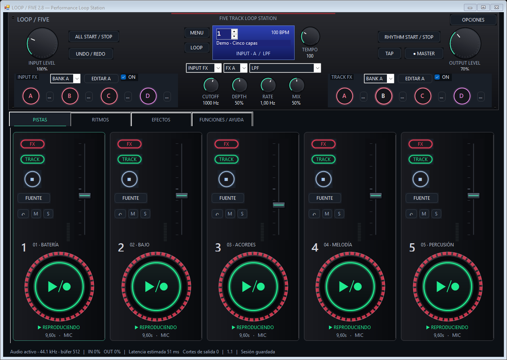

# LoopFive

<p align="center"></p>

**Experimental five-track stereo looper for Windows.** Original audio processing, keyboard controls and a hardware-inspired interface. English and Spanish UI.

> **Beta:** this project is suitable for experimentation and feedback. It has not been validated across a broad range of audio interfaces or for critical live performances. It is not affiliated with BOSS or Roland and does not promise an exact RC-505mkII emulation.



## Download and run

Download the latest portable Windows x64 build from [Releases](https://github.com/XehaCL/LoopFive/releases). Extract the ZIP and open `LoopFive.exe`. Installation is not required.

Requires Windows x64 with .NET Framework 4.x, a working audio output, and an input device for microphone recording. The application uses Windows MME at 44.1 kHz / 16-bit stereo I/O and processes audio internally as 32-bit float. The executable is unsigned.

## Features

- Five stereo loop tracks with recording, playback, overdubbing, undo/redo, reverse, one-shot, level, mute, solo and fades.
- Hardware-style controls, central effect selection, six themes, custom accents and an optional animated Inferno view.
- Input FX and Track FX, four banks of four slots per section, 53 effect families and detailed controls for supported processing modes.
- Editable keyboard shortcuts, MIDI support, procedural rhythms, 99 memories, session files, WAV import/export and master recording.
- Microphone cleanup: rumble and hiss filtering plus noise reduction between sounds.
- Recording-source selection: microphone, another playing track, other-track mix, or microphone plus track mix.

For the detailed scope and implementation history, see [features](docs/FEATURES.es.md), [user guide](docs/USER-GUIDE.es.txt) and [effect research and limitations](docs/EFFECTS-RESEARCH.es.md).

## Quick start

1. Open **Options → Devices**, choose your microphone and output, then apply. Use headphones when monitoring.
2. Click a track ring or press **1–5**: record → play → overdub → play.
3. Use **…** next to FX A–D to edit that effect, or use the central selector. For older sessions, enable **Detailed controls (new mode)** to use the newer algorithms.
4. Open **Options → Themes / language** to switch between English and Spanish.
5. To capture track 1 into track 2, play track 1, choose **SOURCE → Track 1** on track 2, then press track 2's ring. Track-source capture is **before Track FX and master processing**; use **MASTER** to record the final mix with playback effects.

Default shortcuts: **Space** stops all tracks; **Esc** stops immediately; **Shift+1–5** stops a track; **Ctrl+1–5** undoes; **Ctrl+K** opens keyboard configuration; **Ctrl+S/O** saves/opens a session. Shortcuts are app-focused and pause while editing text or dialogs.

## Build from source

No third-party packages, Node, Python or additional .NET SDK are required. The build uses the .NET Framework compiler included with Windows.

```powershell
.\BUILD.ps1
```

The executable is written to `src/build/LoopFive.exe`.

```powershell
.\BUILD.ps1 -RunTests
```

The full suite includes desktop UI and real-device audio checks, which require an interactive Windows desktop with working audio input/output. It briefly opens test forms and accesses the default audio devices. Generated test data stays in the ignored build directories or ignored root PNG previews. The GitHub workflow compiles the application; it does not claim to run hardware audio validation in a hosted runner.

The 2.8 validation report records 511 checks across the engine, audio, effects, language, keyboard, UI and recording sources. Version 2.8.1 changes the icon only; separate checks verified its ICO sizes, embedded executable resource and window icon. Test counts do not establish reliability on every device.

## Known limitations

- Windows MME only: no ASIO, exclusive WASAPI or independent hardware sub outputs. Latency depends on Windows and your audio hardware.
- Several effects are approximations. Formant modeling, full MIDI chord harmonization, commercial amp models, reverse convolution and parts of WARP/TWIST/beat processing are not reproduced fully.
- Individual Track FX destinations use independent per-track processors, which can differ from a summed hardware bus, particularly for nonlinear effects.
- Microphone cleanup cannot separate breath from simultaneous voice without affecting the wanted sound. Freeze captures a short window before sustaining it.
- Old sessions retain legacy effect mode until detailed mode is enabled. Track-source capture does not print global playback effects.
- Native dialogs and driver messages can use the Windows display language.

Sessions and preferences are stored under `%LOCALAPPDATA%\LoopFive`. The repository and release do not contain personal recordings or preferences.

## Contributing

Bug reports and improvements are welcome. See [CONTRIBUTING.md](CONTRIBUTING.md). Include Windows version, LoopFive version, audio device, buffer setting and reproduction steps. Attach audio only if you intend to make it public.

## License and acknowledgments

[MIT](LICENSE) © 2026 XehaCL. Source, generated demo/rhythm content and the original LoopFive icon are included in the project. Effect references and community sources are linked in the research document; no BOSS firmware, proprietary DSP, samples, logos or copied rhythm recordings are included.

---

## Español

LoopFive es un looper estéreo experimental de cinco pistas para Windows. Se publica como beta para recibir comentarios y colaboradores, no como sustituto exacto de la RC-505mkII ni como software validado para actuaciones críticas.

Descarga la versión portable en [Releases](https://github.com/XehaCL/LoopFive/releases). Abre `LoopFive.exe`, configura audio en **Opciones → Dispositivos** y usa los anillos o las teclas **1–5**. Los temas y el idioma están en **Opciones → Temas / idioma**.

Para grabar una pista en otra, reproduce la fuente, elígela con **FUENTE** en el destino y pulsa REC. La captura se toma antes de Track FX; **MASTER** graba la mezcla final con efectos. Consulta la [guía](docs/USER-GUIDE.es.txt) y las [limitaciones de efectos](docs/EFFECTS-RESEARCH.es.md).

Para compilar usa `.\BUILD.ps1`; para ejecutar las pruebas completas, `.\BUILD.ps1 -RunTests`. Estas últimas necesitan escritorio interactivo y dispositivos de audio. No se suben grabaciones ni preferencias personales.
